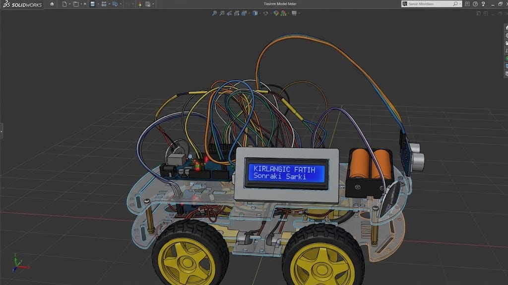

https://github.com/user-attachments/assets/1126491c-d33f-46df-97b3-fb27640b1254

# arduino_projeler

Arduino Uno ile yapılmış 4 tekerlekli robot araba projeleri. Her klasör, Arduino IDE ile doğrudan açılabilen bir sketch'tir.

| Sketch                                                                     | Açıklama                                                                                                                     |
| -------------------------------------------------------------------------- | ---------------------------------------------------------------------------------------------------------------------------- |
| [`4wsArabaSon`](4wsArabaSon/4wsArabaSon.ino)                               | Bluetooth ile kontrol edilen araba: engel algılama, müzik, far, bağlantı kopunca otomatik durma                              |
| [`4wdkayPad3`](4wdkayPad/4wdkaypad3/4wdkaypad3.ino)                        | ROBO-IZCI: keypad ile girilen rotayı kaydedip çalıştıran araba; bekleme adımı, engel algılama, kare çizme ve drift gösterisi |
| [`4wdCizgiIzleyen`](4wdCizgiIzleyen/4wdCizgi/4wdCizgi.ino)                 | QTR sensörlü, PD kontrollü çizgi izleyen robot                                                                               |
| [`4wdCizgiIzleyenHassas`](4wdCizgiIzleyenHassas/4wdCizgiIzleyenHassas.ino) | Aynı çizgi izleyenin daha yavaş giden ve daha yumuşak düzeltme yapan sürümü                                                  |
| [`dfRobotDfPlayerMini`](dfRobotDfPlayerMini/dfRobotDfPlayerMini.ino)       | DFPlayer Mini bağlantı ve hata ayıklama testi                                                                                |

## Gerekli kütüphaneler

Arduino IDE → Kütüphane Yöneticisi'nden kurulur:

- **LiquidCrystal I2C** (16x2 LCD, adres `0x27`)
- **DFRobotDFPlayerMini**
- **Keypad** (Mark Stanley, Alexander Brevig)
- **QTRSensors** (Pololu)

`Wire`, `SoftwareSerial` ve `EEPROM` Arduino ile birlikte gelir.

## Bluetooth araba (4wsArabaSon)

<!-- VIDEO: manuel-kontrol.mp4 dosyasını bu satırın yerine sürükle -->

HC-05/HC-06 modülü donanım seri portuna (D0/D1) 9600 baud ile bağlanır. Kontrol için [arduino_controller_app](https://github.com/FurkanOguzgoksu/arduino_controller_app) kullanılır.

| Komut | İşlev     | Komut              | İşlev                                   |
| ----- | --------- | ------------------ | --------------------------------------- |
| `F`   | İleri     | `S`                | Dur                                     |
| `B`   | Geri      | `P`                | Müziği başlat                           |
| `L`   | Sola dön  | `O`                | Müziği duraklat                         |
| `R`   | Sağa dön  | `C`                | Müziğe devam                            |
| `G`   | İleri sol | `N`                | Sonraki şarkı                           |
| `I`   | İleri sağ | `V`                | Önceki şarkı                            |
| `H`   | Geri sol  | `W` / `w`          | Far aç / kapat                          |
| `J`   | Geri sağ  | `#12` + satır sonu | Far pinini ayarla (EEPROM'a kaydedilir) |

Uygulama araç hareket ederken her 300 ms'de bir `.` gönderir; 1 saniye veri gelmezse araç durur.

| Bağlantı              | Pin       |
| --------------------- | --------- |
| L298N ENA, IN1, IN2   | 11, 10, 9 |
| L298N IN3, IN4, ENB   | 8, 7, 6   |
| HC-SR04 TRIG, ECHO    | 4, 5      |
| DFPlayer TX → Arduino | 2         |
| Arduino → DFPlayer RX | 3         |
| LCD (I2C) SDA, SCL    | A4, A5    |

## ROBO-IZCI (4wdkayPad3)

`2` ileri, `8` geri, `4` sol, `6` sağ, `0` süreli bekleme (saniye + `#`); `5` rotayı çalıştırır, `B` son rotayı tekrarlar, `A` son adımı siler, `*` hepsini siler, `C` drift gösterisi, `D` kare çizer. Tuş açıklamaları LCD'nin alt satırında kayar. İleri giderken 15 cm'den yakın engel görürse durur.

| Bağlantı           | Pin        |
| ------------------ | ---------- |
| L298N ENA, ENB     | 10, 11     |
| L298N IN1–IN4      | A0–A3      |
| HC-SR04 TRIG, ECHO | 13, 12     |
| Keypad satırları   | 9, 8, 7, 6 |
| Keypad sütunları   | 5, 4, 3, 2 |

## Çizgi izleyen (4wdCizgiIzleyen, 4wdCizgiIzleyenHassas)

İki sürüm aynı donanımı ve kodu kullanır; yalnızca PD katsayıları ve taban hız farklıdır. Hassas sürüm daha yavaş gider ve çizgiden sapmaya daha yumuşak tepki verir.

|           | 4wdCizgiIzleyen | 4wdCizgiIzleyenHassas |
| --------- | --------------- | --------------------- |
| Kp        | 0.10            | 0.08                  |
| Kd        | 0.45            | 0.35                  |
| Taban hız | 170             | 125                   |

**Normal sürüm**

<!-- VIDEO: cizgi-izleyen.mp4 dosyasını bu satırın yerine sürükle -->

https://github.com/user-attachments/assets/235b7cf3-40a2-458a-b69d-2c3e19aa4bcf

**Hassas sürüm**

<!-- VIDEO: cizgi-izleyen-hassas.mp4 dosyasını bu satırın yerine sürükle --> 

https://github.com/user-attachments/assets/1a862eb4-4ec3-4c0f-9456-e205e1b655a5

Açılışta dahili LED yanarken (~3 sn) robotu çizginin üzerinde sağa sola gezdirerek kalibre edin.

| Bağlantı            | Pin                    |
| ------------------- | ---------------------- |
| L298N ENA, IN1, IN2 | 5, 6, 7                |
| L298N IN3, IN4, ENB | 8, 9, 10               |
| QTR sensörleri      | A5, A4, A3, A2, A1, A0 |

## DFPlayer Mini testi (dfRobotDfPlayerMini)

DFPlayer TX → A1, A2 → 1K direnç → DFPlayer RX. SD kart FAT32 olmalı ve `MP3/0001.mp3` dosyasını içermelidir. Sonuçlar Seri Monitör'de (9600 baud) görünür.

## 🙏 Teşekkürler

Projenin elektrik kısmıyla ilgili bilgileri [@hasankagansay](https://github.com/hasankagansay)'dan aldım. Desteği için teşekkürler!
